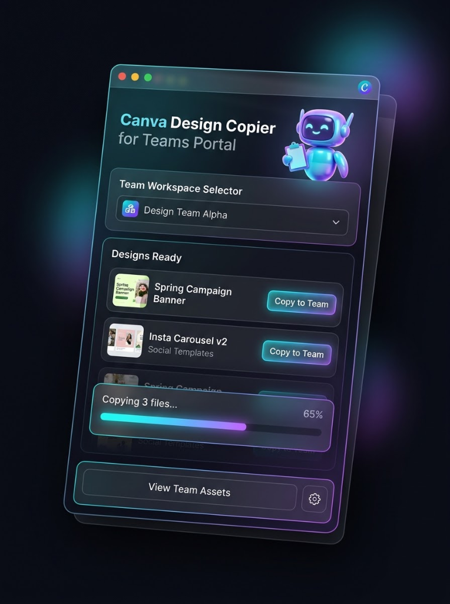
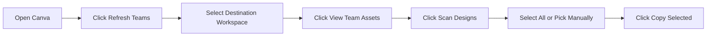

<div align="center">

# Canva Design Copier
### Automated Cross-Team Workspace Migration for Canva

[](https://developer.chrome.com/docs/extensions/mv3/intro/)
[](https://developer.mozilla.org/en-US/docs/Web/JavaScript)
[](LICENSE)
[](https://github.com)

<br/>

<p align="center">
  
</p>

<p align="center">
  A modern, high-precision browser extension to discover Canva workspaces, extract authenticated user designs, and automatically migrate or duplicate assets across team portals.
</p>

</div>

---

## Highlights

- **Automatic Team Detection**: Discovers verified workspace teams in real time using DOM observers and Canva bootstrap payload inspection.
- **Intelligent Design Filter**: Excludes generic templates, "create" banners, category presets, and content planner items so only genuine user designs are captured.
- **Bento Glassmorphic UI**: Inspired by high-end design engineering, featuring vector SVG iconography, smooth spring transitions, and ambient holographic elements.
- **Bulk & Individual Copy Modes**: Transfer all selected items at once with live percentage tracking, or copy individual designs with a single click.
- **Folder Packaging**: Packages designs into designated target folders inside the destination workspace.
- **100% Privacy-First**: Runs entirely in your local browser sandbox. Zero analytics, zero tracking, and zero external network requests.

---

## Table of Contents

- [Quick Start Installation](#quick-start-installation)
- [Step-by-Step Workflow](#step-by-step-workflow)
  - [Step 1: Open Canva](#step-1-open-canva)
  - [Step 2: Refresh & Select Destination Team](#step-2-refresh--select-destination-team)
  - [Step 3: Open Team Assets & Scan Designs](#step-3-open-team-assets--scan-designs)
  - [Step 4: Select Designs to Transfer](#step-4-select-designs-to-transfer)
  - [Step 5: Start Migration](#step-5-start-migration)
- [Transfer Strategies](#transfer-strategies)
- [Smart Filter System](#smart-filter-system)
- [Architecture & File Structure](#architecture--file-structure)
- [Troubleshooting & FAQ](#troubleshooting--faq)
- [License](#license)

---

## Quick Start Installation

1. **Clone or Download the Repository:**
   ```bash
   git clone https://github.com/aseerawsaf45-dev/canva-team-migrator.git
   ```
   *(Or download and extract the ZIP file to your computer).*

2. **Open Extensions in Chrome / Chromium:**
   - In your browser's address bar, navigate to:
     ```
     chrome://extensions
     ```
   - *Works in Google Chrome, Brave, Microsoft Edge, Opera, and Vivaldi.*

3. **Enable Developer Mode:**
   - Turn on the **Developer mode** toggle in the top-right corner.

4. **Load the Extension:**
   - Click the **Load unpacked** button in the top-left corner.
   - Select the `canva-team-migrator` project folder.

5. **Pin Extension:**
   - Click the Extensions puzzle piece icon in the browser toolbar and pin **CanvaPortal — Team Design Migrator** for quick access.

---

## Step-by-Step Workflow

Follow this workflow to migrate your assets:



### Step 1: Open Canva
Navigate to [canva.com](https://www.canva.com) and ensure you are logged in to your account.

### Step 2: Refresh & Select Destination Team
1. Click the **Canva Design Copier** icon in your browser toolbar to open the popup.
2. In the **Team Workspace Selector** card, click **Refresh**.
   - The extension queries active workspace state and automatically populates all verified teams.
3. Click the **Team Workspace Selector** dropdown to view available teams.
4. Select the target team where you want your designs copied.
   - The selected team is highlighted with an active badge.
   - *(Optional: Click **Switch** on any listed team to change your current Canva workspace directly).*

> [!TIP]
> If a team does not show up right away, click your **Profile Avatar** in Canva once. The background mutation observer will capture the complete workspace list instantly.

### Step 3: Open Team Assets & Scan Designs
1. Click the **View Team Assets** button in the extension (or open `canva.com/projects` in Canva).
2. Inside your projects or folder view, click **Scan Designs**.
3. The extension automatically smooth-scrolls through the viewport to load and parse design cards.
   - The verified design count is displayed on the **Designs Ready** counter badge.

### Step 4: Select Designs to Transfer
- **Select All**: Toggle the **Select All** checkbox to include all discovered designs.
- **Manual Selection**: Check or uncheck individual items in the list.
- The counter dynamically indicates `X selected`.

### Step 5: Start Migration
- **Bulk Migration**:
  - Click **Copy Selected** at the bottom.
  - The live progress dock will reveal real-time percentage and status updates (`Copying 3 files...  65%`).
- **Single Design Copy**:
  - Click the **Copy to Team** button on any individual design row to transfer that item immediately.

---

## Transfer Strategies

Click the **Gear icon (⚙)** in the footer to access migration settings:

| Strategy | Behavior | Best Used For |
| :--- | :--- | :--- |
| **Package into Folder (Recommended)** | Creates a project folder in the destination team and moves designs inside it. | Batch migrations of entire projects or campaigns. |
| **Individual Design Copy** | Duplicates designs one-by-one into the target workspace root directory. | Selective copying of individual assets. |

You can also customize the **Target Folder Name** (default: `Migrated Project`) and view diagnostic logs in the **Live Activity Console**.

---

## Smart Filter System

Canva displays generic creation buttons ("New presentation", "Whiteboard", "Content planner") that link to template tools. This extension incorporates strict validation layers:

1. **Design ID Verification**: Only items matching Canva user design ID formats (`DA[A-Za-z0-9_-]{8,}`) are parsed.
2. **Structural Scoping**: Links inside navigation sidebars, headers, dialogs, and template recommendation carousels are rejected.
3. **Keyword Blocklist**: Suppresses category presets, generic template labels, dimensions (`1920x1080`), and navigation terms.

---

## Architecture & File Structure

```
canva-team-migrator/
├── manifest.json              # Chrome Extension Manifest V3 configuration
├── popup.html                 # Bento glassmorphic UI interface
├── popup.js                   # UI event handlers, storage caching, & progress tracking
├── content.js                 # DOM scanner, viewport scroller, & UI automation
├── injected.js                # Main-world JSON.parse interceptor for team Brand IDs
├── robot_mascot_transparent.png # Alpha-masked 3D ambient mascot asset
├── preview.png                # Extension interface screenshot
├── icon16.png                 # Toolbar icon (16x16)
├── icon48.png                 # Extension manager icon (48x48)
├── icon128.png                # Chrome Web Store icon (128x128)
└── README.md                  # Project documentation
```

---

## Troubleshooting & FAQ

<details>
<summary><strong>Why does the designs list show 0 designs?</strong></summary>

Ensure your Canva tab is on the **Projects** page (`canva.com/projects`) or inside a folder before clicking **Scan Designs**. The extension scrolls the projects grid to extract authentic cards.
</details>

<details>
<summary><strong>Why do I see an "Extension disconnected" message?</strong></summary>

If you updated extension files or reloaded Chrome, the active tab loses connection with the background script. Simply refresh your Canva tab (`F5`) and reopen the popup.
</details>

<details>
<summary><strong>Does this extension collect or send data to external servers?</strong></summary>

No. The extension operates completely on client-side browser automation. It communicates strictly between your active Canva tab and the extension popup using Chrome's native messaging APIs. No third-party servers, databases, or analytics are used.
</details>

---

## License

Distributed under the MIT License. See [LICENSE](LICENSE) for more details.
